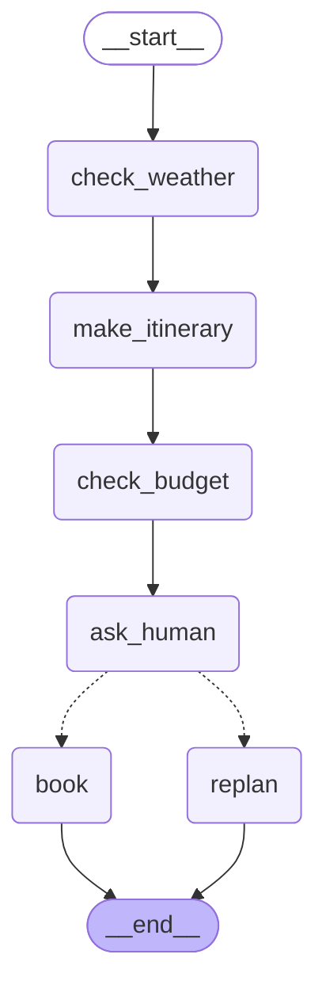

# 第15周 · 旅行规划 Agent

## 这个 Agent 做什么

用户给出城市和天数。Agent 先查天气，再按天气定室内游还是户外游并写出行程，然后按行程类型和天数算预算。算完后停下来请人确认：批准就预订（扣款），拒绝就标记为重新规划。

天气是模拟数据，扣款只是 print，不会真的扣钱。

## 流程图

由 `print(graph.get_graph().draw_mermaid())` 从代码自动生成。实线是普通边，虚线是条件边（运行时由 `route_by_decision` 决定走哪条）。



## 字段流转表

| 节点 | 从单子上读哪几栏 | 交回的纸条里有哪几栏 |
|---|---|---|
| check_weather | city | weather、logs |
| make_itinerary | city、days、weather | style、itinerary、logs |
| check_budget | style、days | budget、logs |
| ask_human | itinerary、budget | decision、logs |
| route_by_decision | decision | 不交纸条，只返回分支名字 |
| book | budget | logs |
| replan | 不需要读取 | logs |

city、days 和初始 logs 是投单时给的。logs 贴了 `add`，每张纸条都追加在后面；其他栏没贴，按默认规则新值覆盖旧值。

## 怎么运行

在 python-learning 目录下：

```
python week15/day6_trip_agent.py
```

## 今日读码题

**make_itinerary 是从哪里拿到 check_weather 的结果的？**

第一个节点 check_weather 执行完后，通过 return 交回结果，框架更新到 State 中，第二个节点执行时就可以读取。具体是 `weather` 这一栏。

## 今天得出的结论

- 有副作用的动作（扣款）要放在确认批准之后，单独放进只有批准这条路才会走到的节点（book）里。放在 interrupt 之前会重复扣；放在 interrupt 之后、同一个节点里，拒绝了也会扣。
- 写几次取决于有几张纸条带了这一栏；reducer 只决定每次怎么写（追加还是覆盖）。
- 节点执行顺序不等于数据依赖链：天气通过 weather → style → budget 接力影响预算，itinerary 不在这条链上。
- 改接线时，除了看线连没连通，还要检查每个节点要读的栏，走到它之前上游有没有交过。框架在 compile 时不检查这个，运行到那一行才报 KeyError。
- 条件边不带暗号表时程序照样能跑，但画出来的图里 book、replan 是断开的。带上表，代码本身就说清了所有可能的路。
- 查不到天气时代码会当成户外游并直接扣款，这不合理。改进思路：在 check_weather 后面加一条条件边，天气未知就不往下规划，或者用 interrupt 停下来问人。
