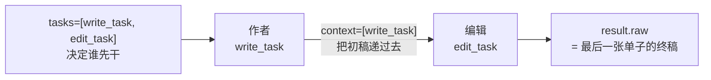
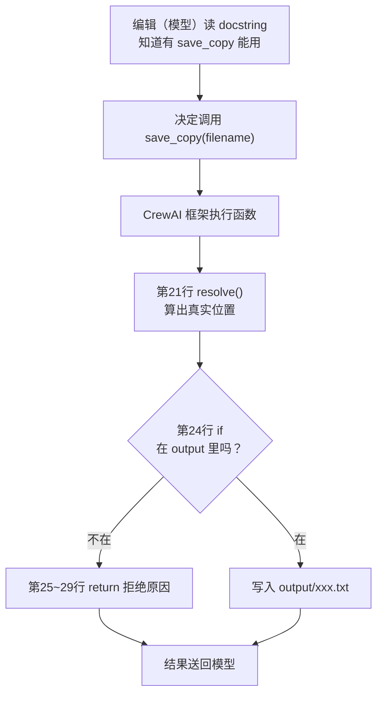
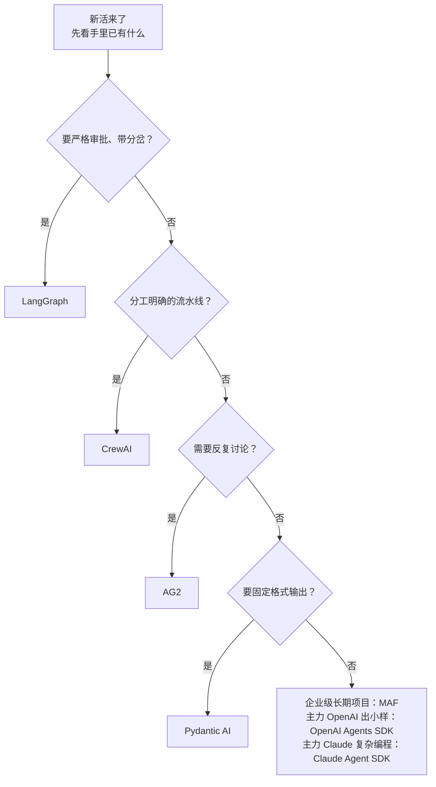

# 第17周笔记总结：CrewAI 多 Agent + 框架选型

> 标〔补〕的是 Claude 补充的，其余都是我自己的原话。

---

## 一、每天一句（原话）

| 天 | 今天一句话 |
|---|---|
| D1 | 用 CrewAI 搭了一个员工+一张工单的文案小组，DeepSeek 写法兰绒毛毯文案跑通；装环境踩了三个坑（CrewAI 不支持 3.14 另装 3.12；PowerShell 禁止运行激活脚本；360 拦截 onnxruntime.dll，已加信任区） |
| D2 | 在作者后面加了运营员工（duo_crew.py），靠 context=[write_task] 拿初稿；第二次跑作者又编了"立减20"、运营没拦，给运营工单补了"假促销一律删除 + 真实商品信息"后修好；踩坑：注释 description 时漏注释了收尾的 ), |
| D3 | 做了写细版v2（不要求促销、字数80~120）和分层版boss_crew.py；踩坑：len(result.raw)把修改清单也数进去了（421/375/447），终稿字数只能手数 |
| D4 | 给编辑配了 save_copy 存稿工具（@tool + docstring + resolve 路径检查），终稿存进 output/cup.txt；踩坑：type 读 UTF-8 文件乱码，改用 Get-Content -Encoding utf8 |
| D5 | 读了 AutoGen 分家和 AG2 对话式代码，记了一页框架现状笔记；最乱的是三家关系（谁重构、谁保留老写法）和点号前后谁是发起方 |
| D6 | 做了七个框架的选型对比表并推送（17ca6d1）；最乱的是把"我用的编程助手"和"我做的Agent用的模型"搞混 |
| D7 | （收工时补） |

---

## 二、本周三个流程图

### 1. 写稿系统（duo_crew_v2.py，顺序模式）

- 〔补〕顺序模式是一条没分岔的直线，每一步都照跑，写不出"退回重改"。
- 〔补〕分层模式（boss_crew.py）：不按排序走，主管模型临场派活，结果说不准。

### 2. 存稿工具（save_tool.py）

- 〔补〕拦人的是第24行 if，不是靠工单叮嘱。

### 3. 框架对比表：怎么挑

- 〔补〕这张图从 week17/框架对比表.md 的"最适合"一列简化而来，细节看原表。

---

## 三、闭卷读码结果（D7）

| 题 | 对错 | 记一笔 |
|---|---|---|
| 1 谁先干 | ✅ | 看 tasks=[title_task, check_task] 的顺序，没被 agents 花名册干扰 |
| 2 质检员的输入 | ✅ | context=[title_task] 拿初稿〔补：再加自己工单上的要求〕 |
| 3 打印的是什么 | ✅ | 最后一张单子的产出〔补：打印在 print(result.raw)〕 |
| 加分 对调 tasks | ✅ 提示后 | 冒在 Crew(...) 那行，context 依赖排在后面的单子，"还没写就要改"，建组时直接拦下 |

---

## 四、三题答案

**1. 这周最想记住的一个坑**
CrewAI 不支持 3.14 另装 3.12。为什么选它：加深一点环境类的印象。
〔补〕以后装新框架，先查它支持哪些 Python 版本。

**2. CrewAI 和 LangGraph 一句话区别**
crewai：主要写人设和工单，下一步工单排序表决定。LangGraph：图、节点、边，下一步由路由函数决定。
〔补〕CrewAI 按排序走是顺序模式；分层模式由主管模型决定。路由函数是交给条件边的那个 Python 函数，return 下一站的名字。

**3. D2 编辑需求第一版最大的问题**
简单流程复杂化了。
〔补〕第一版写"退回作者来回改"，顺序模式是直线，写不出回头路。
